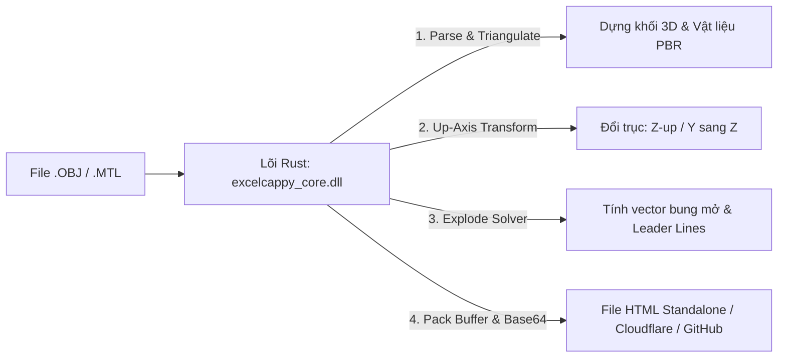

# SỔ TAY HƯỚNG DẪN SỬ DỤNG TÍNH NĂNG UNTUBE (3D CAD TO WEB VIEWER)

> **Untube 3D CAD Engine** là phân hệ công nghệ cao tích hợp độc quyền trên Add-in **ExcelCappy**. Phân hệ được thiết kế để giải quyết bài toán cốt lõi trong ngành cơ khí, chế tạo máy, nội thất và kiến trúc: **Chuyển đổi tức thì bản vẽ lắp ráp 3D CAD (`.obj`, `.mtl`) thành trang Web 3D tương tác đa nền tảng siêu nhẹ**, cho phép người dùng và khách hàng xoay 360°, bóc tách từng chi tiết (Exploded View) trên mọi thiết bị (PC, Mac, iPhone, iPad, Android) mà **không cần cài đặt phần mềm CAD, không cần web server và kháng 100% lỗi CORS**.

---

## MỤC LỤC
1. [Tổng quan & Kiến trúc Lõi Rust Native](#1-tổng-quan--kiến-trúc-lõi-rust-native)
2. [Cách mở tính năng trên thanh Ribbon Excel](#2-cách-mở-tính-năng-trên-thanh-ribbon-excel)
3. [Chuẩn bị file 3D từ các phần mềm CAD phổ biến](#3-chuẩn-bị-file-3d-từ-các-phần-mềm-cad-phổ-biến)
4. [Hướng dẫn thao tác trên Giao diện UntubeForm](#4-hướng-dẫn-thao-tác-trên-giao-diện-untubeform)
   - [Kéo thả & Nạp file dữ liệu](#kéo-thả--nạp-file-dữ-liệu)
   - [Định hướng trục không gian (Up-Axis) - Khắc phục vật thể bị nằm](#định-hướng-trục-không-gian-up-axis---khắc-phục-vật-thể-bị-nằm)
   - [Lựa chọn Giao diện hiển thị (Theme Dark / Light)](#lựa-chọn-giao-diện-hiển-thị-theme-dark--light)
   - [Các định dạng xuất đa nền tảng](#các-định-dạng-xuất-đa-nền-tảng)
5. [Hướng dẫn tương tác trên Trang Web 3D Viewer thành phẩm](#5-hướng-dẫn-tương-tác-trên-trang-web-3d-viewer-thành-phẩm)
   - [Điều khiển góc nhìn (OrbitControls)](#điều-khiển-góc-nhìn-orbitcontrols)
   - [Cụm công cụ Xoay đổi trục trực tiếp (On-the-fly)](#cụm-công-cụ-xoay-đổi-trục-trực-tiếp-on-the-fly)
   - [Bóc tách linh kiện & Đường chỉ dẫn (Exploded View & Leader Lines)](#bóc-tách-linh-kiện--đường-chỉ-dẫn-exploded-view--leader-lines)
   - [Bộ lọc & Cô lập chi tiết (Part Isolation Pills)](#bộ-lọc--cô-lập-chi-tiết-part-isolation-pills)
6. [Chính sách Bản quyền & Quota chuyển đổi](#6-chính-sách-bản-quyền--quota-chuyển-đổi)
7. [Các câu hỏi thường gặp & Mẹo tối ưu (FAQ)](#7-các-câu-hỏi-thường-gặp--mẹo-tối-ưu-faq)

---

## 1. TỔNG QUAN & KIẾN TRÚC LÕI RUST NATIVE

Khác với các công cụ web 3D thông thường phụ thuộc vào việc tải file trung gian qua mạng dễ bị chặn bởi chính sách CORS (`Cross-Origin Resource Sharing`) khi mở cục bộ `file:///`, **Untube** được xây dựng trên triết lý **Rust Native Core First**:
- **Bóc tách hình học siêu tốc:** Xử lý hàng vạn đỉnh và mặt tam giác từ file `.obj`, chia nhóm linh kiện theo `Object`, `Group` hoặc `Material` trong thời gian < 1 giây.
- **Tính toán cơ học & Bounding Box:** Tự động tính tâm xoay không gian, kích thước 3 chiều $(X, Y, Z)$ và tính toán trước các vector bung mở đa chiều.
- **Đóng gói Float32Array Contiguous Buffer:** Nén toàn bộ tọa độ hình học thành buffer nhị phân nhỏ gọn (36 bytes / tam giác) và mã hóa Base64 nhúng thẳng vào file HTML duy nhất. File sau khi xuất có thể gửi qua Zalo, Email, mở xem ngay lập tức mà không cần mạng Internet.

---

## 2. CÁCH MỞ TÍNH NĂNG TRÊN THANH RIBBON EXCEL

Trên thanh Ribbon của Excel sau khi cài đặt ExcelCappy:
1. Tìm đến Tab **`Untube`** trên thanh công cụ.
2. Tại đây có 3 nút điều khiển:
   - **`3D to Web`**: Khởi động trung tâm chuyển đổi và bóc tách Untube 3D.
   - **`Thư mục Mẫu`**: Mở nhanh thư mục chứa file mô hình 3D mẫu (`.obj`, `.mtl`) có sẵn trong máy để thử nghiệm.
   - **`Hướng dẫn`**: Hiển thị bảng tóm tắt nhanh các phím tắt và thao tác chuột điều khiển 3D.

---

## 3. CHUẨN BỊ FILE 3D TỪ CÁC PHẦN MỀM CAD PHỔ BIẾN

Untube hỗ trợ định dạng **Wavefront OBJ (`.obj`)** và file vật liệu kèm theo **MTL (`.mtl`)**. Để xuất file đạt chất lượng bóc tách chi tiết tốt nhất:

### A. SolidWorks
1. Mở cụm lắp ráp (Assembly) trong SolidWorks.
2. Vào **File** > **Save As...** > chọn kiểu file **Wavefront (*.obj)** (hoặc sử dụng tính năng Export / Print 3D).
3. **Lưu ý quan trọng về hệ trục:** SolidWorks sử dụng mặc định trục $Y$-up (trục $Y$ là chiều cao đứng). Khi nạp vào Untube, hãy chọn tùy chọn **`Y sang Z (Đổi Y-Z)`** để vật thể đứng thẳng.

### B. Rhinoceros (Rhino) / Grasshopper
1. Chọn các khối cần xuất, gõ lệnh `Export` hoặc vào **File** > **Export Selected...**.
2. Chọn định dạng **Wavefront (*.obj)**.
3. Trong bảng thiết lập xuất của Rhino:
   - Mục **Export object names**: Chọn **As OBJ objects (`o` tag)** hoặc **As OBJ groups (`g` tag)**.
   - Mục **Export material definitions**: Tích chọn để Rhino tự động tạo file `.mtl` màu sắc.

### C. ZW3D / AutoCAD / Inventor / Fusion 360 / Blender
- **ZW3D / AutoCAD:** Xuất trực tiếp `.obj`, giữ nguyên tên Part/Layer.
- **Blender:** File > Export > Wavefront (`.obj`). Chọn **Include: Material Groups**, Forward: `-Z Forward`, Up: `Y Up` (hoặc `Z Up`).
- **Lưu ý file màu sắc (`.mtl`):** Đặt file `.mtl` nằm chung một thư mục và giữ nguyên tên với file `.obj`. Untube sẽ tự động dò tìm và nạp bảng màu sắc diffuse ($K_d$) cho từng linh kiện.

---

## 4. HƯỚNG DẪN THAO TÁC TRÊN GIAO DIỆN UNTUBEFORM

Giao diện **Untube** được thiết kế trực quan, chia thành các khu vực chức năng rõ ràng:

### Kéo thả & Nạp file dữ liệu
- **Kéo thả chuột:** Kéo trực tiếp file `.obj` từ File Explorer thả vào vùng nét đứt màu xanh *"Kéo & Thả file .OBJ hoặc .MTL vào đây"*.
- **Tự động nhận diện:** Ngay khi nhận file `.obj`, hệ thống tự động quét tìm file `.mtl` cùng tên trong thư mục và tự điền thư mục xuất mặc định `untube_web3d`.

### Định hướng trục không gian (Up-Axis) - Khắc phục vật thể bị nằm
Một số phần mềm CAD xuất file theo hệ trục đứng khác nhau. Untube cung cấp giải pháp chuyển đổi tọa độ toán học chính xác:
| Lựa chọn trục đứng | Đối tượng áp dụng | Cơ chế toán học |
| :--- | :--- | :--- |
| **`Z-up (Mặc định CAD)`** | AutoCAD, Rhino, ZW3D, Revit, 3ds Max | Giữ nguyên tọa độ $(X, Y, Z)$ gốc. |
| **`Y sang Z (Đổi Y-Z)`** | **SolidWorks, Blender, Maya** | Quay $90^\circ$ quanh trục $X$: $X'=X, Y'=-Z, Z'=Y$. Vật thể chuyển từ nằm sang đứng thẳng, bảo toàn 100% hướng mặt phẳng tam giác. |
| **`X sang Z (Đổi X-Z)`** | Các bản vẽ mô hình thiết kế nằm ngang theo trục $X$ | Quay $90^\circ$ quanh trục $Y$: $X'=Z, Y'=Y, Z'=-X$. |
| **`Đảo ngược Z (Invert)`** | Bản vẽ bị lộn ngược đầu xuống đáy | Quay $180^\circ$ quanh trục $X$: $X'=X, Y'=-Y, Z'=-Z$. |

### Lựa chọn Giao diện hiển thị (Theme Dark / Light)
- **Dark Theme (Mặc định):** Phù hợp môi trường làm việc kỹ thuật, ánh sáng Studio 3 điểm PBR nổi khối, dịu mắt, làm nổi bật đường nét linh kiện.
- **Light Theme (Sáng):** Nền trắng sáng, viền đậm tương phản cao, phù hợp đưa vào tài liệu thuyết trình, in ấn hoặc nhúng vào trang tin tức văn phòng.

### Các định dạng xuất đa nền tảng
1. **⭐ Single-File HTML Standalone (Khuyến nghị):**
   - Tạo ra 1 file `.html` duy nhất (khoảng 200 - 500 KB).
   - Chứa sẵn toàn bộ thư viện 3D WebGL và dữ liệu mô hình.
   - Mở offline 100%, gửi Zalo/Messenger/Email cho khách xem ngay trên điện thoại hoặc máy tính mà không cần cài thêm bất kỳ app nào.
2. **Cloudflare Package:**
   - Tạo thư mục chứa `index.html`, `model.bin`, `wrangler.toml` và file `deploy.bat`.
   - Bấm đúp vào `deploy.bat` để triển khai mô hình 3D lên Cloudflare toàn cầu chỉ trong 1 cú click.
3. **GitHub Pages Package:**
   - Tạo thư mục `github_pages_docs/` với đầy đủ `index.html`, `404.html`, `model.bin`, `.nojekyll` và `README.md`.
   - Đưa vào GitHub để có link xem 3D trực tuyến miễn phí vĩnh viễn mang thương hiệu cá nhân/doanh nghiệp.
4. **Blogspot / Web Embed Code:**
   - Tạo file HTML tối ưu viền nhúng và file text chứa sẵn đoạn mã `<iframe ...>` để copy dán vào bài viết WordPress hoặc Google Blogspot.
5. **All-in-One:**
   - Xuất đồng thời tất cả các định dạng trên vào cùng thư mục.

---

## 5. HƯỚNG DẪN TƯƠNG TÁC TRÊN TRANG WEB 3D VIEWER THÀNH PHẨM

Khi mở file `.html` tạo bởi Untube, bạn sẽ có một giao diện tương tác 3D chuyên nghiệp:

### Điều khiển góc nhìn (OrbitControls)
- **Chuột trái / 1 ngón tay (Màn hình cảm ứng):** Nhấp giữ và rê để xoay đa hướng 360°.
- **Chuột phải / 2 ngón tay:** Nhấp giữ và di chuyển để Pan (trượt tịnh tiến góc nhìn).
- **Cuộn bánh xe chuột / Chụm 2 ngón tay:** Zoom phóng to hoặc thu nhỏ chi tiết.

### Cụm công cụ Xoay đổi trục trực tiếp (On-the-fly)
Nằm tại góc dưới bên phải viewport (cạnh các nút *Mặc định*, *Tự xoay*):
- **`🔄 Đứng (Y-Z)`:** Nếu mở file mà thấy vật thể đang nằm ngang (do lúc xuất quên chưa chọn đổi trục), chỉ cần **bấm 1 click vào nút này**, vật thể sẽ tự động xoay đứng $90^\circ$ ngay lập tức quanh tâm hình học.
- **`🔄 Xoay (X-Z)`:** Bấm để xoay đổi hướng nhìn mặt trước/mặt bên $90^\circ$.
- **`Mặc định`:** Đặt lại toàn bộ góc camera, trả chiều xoay về trạng thái gốc.
- **`Tự xoay`:** Kích hoạt chế độ quay tự động 360° để trình diễn sản phẩm rảnh tay.

### Bóc tách linh kiện & Đường chỉ dẫn (Exploded View & Leader Lines)
- **Thanh trượt Tách cụm (Explode):** Kéo từ `0%` (lắp ráp hoàn chỉnh) đến `100%` (bung toàn bộ linh kiện ra ngoài).
- **Đường chỉ dẫn 3D (Leader Guide Lines):** Khi bung mở, các đường nét đứt màu xanh sẽ tự động nối từ vị trí ban đầu đến vị trí bung của từng chi tiết, giúp người xem hình dung rõ quy cách lắp ráp từng bộ phận.
- **Các chế độ bung:**
  - `3D (X+Y+Z)`: Bung mở hướng tâm tỏa đều theo không gian 3 chiều.
  - `Trục ngang (X)`: Chỉ bung các chi tiết trượt sang hai bên trái/phải.
  - `Trục dọc (Y)`: Chỉ bung các chi tiết trượt theo chiều sâu trước/sau.
  - `Trục đứng (Z)`: Chỉ bung các chi tiết trượt theo chiều đứng lên/xuống (rất hữu ích cho kết cấu khuôn, bu-lông ốc vít hoặc đồ gỗ nội thất).
- **Cự ly bung:** Chọn khoảng cách bung $1\times$ (chuẩn), $1.5\times$ (rộng), $2\times$ (cực rộng), $3\times$ (toàn cảnh).

### Bộ lọc & Cô lập chi tiết (Part Isolation Pills)
- Dưới chân trang web là thanh danh sách các chi tiết (`#01`, `#02`, `#03`...).
- **Nhấp vào một chi tiết bất kỳ:** Chi tiết đó sẽ được làm nổi bật 100%, đồng thời toàn bộ các chi tiết còn lại sẽ tự động chuyển sang chế độ trong suốt mờ (20% opacity) và tự động bung nhẹ để người xem soi rõ vị trí lắp ráp bên trong.
- **Nhấp `Tất cả linh kiện`:** Khôi phục hiển thị đầy đủ toàn bộ mô hình.

---

## 6. CHÍNH SÁCH BẢN QUYỀN & QUOTA CHUYỂN ĐỔI

Cơ chế bản quyền của Untube được quản lý nghiêm ngặt từ **Lõi Rust Native Core (`excelcappy_core`)** gắn liền với chữ ký số phần cứng máy tính (HWID), không thể can thiệp hay bẻ khóa:

| Quyền lợi / Tính năng | Bản Miễn Phí (Free Tier) | Bản PRO / VIP |
| :--- | :---: | :---: |
| **Định dạng xuất file** | Single-File HTML Standalone | Toàn bộ (HTML Standalone, Cloudflare, GitHub, Web Embed) |
| **Giới hạn số lần chuyển đổi (Quota)** | **1 file / mỗi 3 giờ** (180 phút hồi chiêu) | **Không giới hạn (Unlimited)** |
| **Bóc tách linh kiện (Exploded View)** | Đầy đủ 4 trục (3D, X, Y, Z) | Đầy đủ 4 trục (3D, X, Y, Z) |
| **Xoay trục trực tiếp trên Web** | Có sẵn (`🔄 Đứng`, `🔄 Xoay`) | Có sẵn (`🔄 Đứng`, `🔄 Xoay`) |
| **Thời hạn sử dụng** | Vĩnh viễn | Theo thời hạn gói kích hoạt |

> 💡 **Mẹo:** Người dùng có thể bấm trực tiếp nút **`⭐ Nâng cấp PRO`** ngay trên form Untube để kích hoạt bản quyền nhanh chóng qua hệ thống quét mã QR tự động.

---

## 7. CÁC CÂU HỎI THƯỜNG GẶP & MẸO TỐI ƯU (FAQ)

### Q1: Tại sao khi mở file HTML lên, mô hình của tôi lại nằm ngang hoặc úp mặt?
> **Giải pháp:** 
> - **Cách 1 (Nhanh nhất):** Bấm trực tiếp nút **`🔄 Đứng (Y-Z)`** trên góc phải của trang Web để dựng đứng ngay lập tức.
> - **Cách 2 (Chuẩn hóa từ gốc):** Khi chuyển đổi trong ExcelCappy, tại ô **Trục đứng (Up-Axis)**, chọn mục **`Y sang Z (Đổi Y-Z: SolidWorks, Blender)`**.

### Q2: Tại sao mô hình của tôi xuất ra chỉ có màu xám trắng mà không có màu sắc chi tiết?
> **Giải pháp:** Hãy kiểm tra xem file `.mtl` có nằm cùng thư mục với file `.obj` hay không. Khi xuất file từ Rhino hoặc SolidWorks, hãy đảm bảo đã tích chọn tùy chọn xuất kèm vật liệu (*Export Materials*).

### Q3: Tôi gửi file HTML cho khách hàng nhưng khách mở bằng iPhone/Android có xem được không?
> **Trả lời:** Mở xem hoàn hảo 100%! Trình duyệt Safari trên iOS và Chrome trên Android đều tích hợp sẵn bộ tăng tốc đồ họa WebGL phần cứng. Khách hàng chỉ cần chạm 1 ngón để xoay và chụm 2 ngón để phóng to thu nhỏ cực kỳ mượt mà.

### Q4: Kích thước file OBJ thế nào là tối ưu cho Web?
> **Mẹo kỹ thuật:** File OBJ có số lượng mặt tam giác từ **2.000 đến 100.000 tam giác** (dung lượng file HTML thành phẩm khoảng 150 KB – 5 MB) sẽ tải gần như tức thì trong vòng 0.2 giây trên mọi đường truyền di động 4G. Nếu mô hình quá nặng do chứa nhiều ren ốc vít hoặc lưới quá dày, hãy dùng tính năng *Reduce Mesh* trong phần mềm CAD trước khi xuất.

